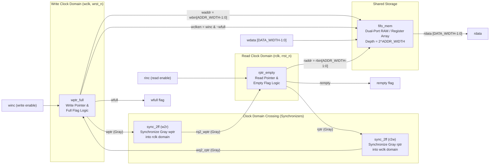

# Production-Quality Asynchronous FIFO in SystemVerilog with UVM & Class-Based Verification

[](https://en.wikipedia.org/wiki/SystemVerilog)
[]()
[]()
[]()
[]()

A parameterizable, synthesizable, dual-clock **Asynchronous FIFO** engineered from scratch to production ASIC standards. Accompanied by Clock Domain Crossing (CDC) static analysis, SystemVerilog Assertions (SVA), Functional Coverage, an IEEE 1800 class-based testbench, and a full UVM 1.2 verification environment.

---

## 1. System Architecture

The design implements the classic **Cummings CDC architecture**, strictly isolating the write clock domain (`wclk`) from the read clock domain (`rclk`) with zero combinational glue logic across clock boundaries.



### Module Hierarchy
- [`rtl/async_fifo.sv`](rtl/async_fifo.sv): Parameterized top-level wrapper interconnecting submodules.
- [`rtl/fifo_mem.sv`](rtl/fifo_mem.sv): Dual-port synthesizable storage array with First-Word Fall-Through (FWFT) zero-latency combinational read.
- [`rtl/sync_2ff.sv`](rtl/sync_2ff.sv): Parameterized 2-stage flip-flop synchronizer with `(* ASYNC_REG = "TRUE" *)` synthesis attributes.
- [`rtl/wptr_full.sv`](rtl/wptr_full.sv): Write domain binary counter, Gray conversion, and registered `wfull` logic.
- [`rtl/rptr_empty.sv`](rtl/rptr_empty.sv): Read domain binary counter, Gray conversion, and registered `rempty` logic.

---

## 2. Mathematical Derivation of Full and Empty Flags

Let pointer width $P = N + 1$, where $N = \text{ADDR\_WIDTH}$ ($\text{DEPTH} = 2^N$).

### Why $N+1$ Bits?
An $N$-bit address indexes $2^N$ locations. Adding an extra $(N+1)^{\text{th}}$ MSB distinguishes **completely full** from **completely empty**:
- Identical MSBs and identical addresses $\implies$ **FIFO is EMPTY**.
- Different MSBs and identical addresses $\implies$ **FIFO is FULL** (write wrapped around read by $2^N$).

### Empty Condition (Read Domain)
In the read domain, the FIFO is empty when the read pointer matches the synchronized write pointer:
$$\text{rempty\_val} = (\text{rptr\_next} == \text{rq2\_wptr})$$
Because 2-FF synchronizer latency delays the arrival of write pointers by 2 `rclk` edges, `rempty` deassertion lags real write activity. This is **pessimistic / fail-safe**: underflow is mathematically impossible.

### Full Condition (Write Domain)
In binary, full occurs when $wbin[N] \neq rbin[N]$ and $wbin[N-1:0] == rbin[N-1:0]$.

Converting to Gray code via $G[i] = B[i] \oplus B[i+1]$:
1. **MSB ($i = N$)**:
   $$wptr[N] = wbin[N] = \overline{rbin[N]} = \overline{rptr[N]} \quad (\text{Inverted})$$
2. **2nd MSB ($i = N-1$)**:
   $$wptr[N-1] = wbin[N-1] \oplus wbin[N] = rbin[N-1] \oplus \overline{rbin[N]} = \overline{rptr[N-1]} \quad (\text{Inverted})$$
3. **Lower bits ($i < N-1$)**:
   $$wptr[i] = wbin[i] \oplus wbin[i+1] = rbin[i] \oplus rbin[i+1] = rptr[i] \quad (\text{Identical})$$

Hence, the hardware Gray-code full condition is:
```systemverilog
assign wfull_val = (wptr_next == {~wq2_rptr[ADDR_WIDTH : ADDR_WIDTH-1], 
                                   wq2_rptr[ADDR_WIDTH-2 : 0]});
```

---

## 3. Clock Domain Crossing (CDC) Principles

1. **Metastability & MTBF**: Asynchronous setup/hold violations are mitigated using 2-stage flip-flop synchronizers.
2. **Hamming Distance Guarantee**: Binary counters toggle multiple bits simultaneously, risking multi-bit sampling skew. Gray pointers guarantee **at most 1 bit changes per cycle**, eliminating race skew.
3. **Synthesis Pragmas**:
   ```systemverilog
   (* ASYNC_REG = "TRUE" *) logic [WIDTH-1:0] sync_stage1;
   (* ASYNC_REG = "TRUE" *) logic [WIDTH-1:0] sync_stage2;
   ```
   Prevents shift-register LUT (SRL) extraction and places flip-flops into adjacent physical slice registers.
4. **Static Timing Constraints (SDC)**:
   ```tcl
   set_max_delay -from [get_cells wptr_reg*] -to [get_cells u_sync_w2r/sync_stage1_reg*] \
                 -datapath_only [get_property -min PERIOD [get_clocks rclk]]
   ```

---

## 4. Verification Suite & Test Results

The repository features three complementary verification layers:
1. **Directed Smoke Test** ([`tb/tb_basic.sv`](tb/tb_basic.sv)): Basic sequencing and waveform generation.
2. **15-Scenario Advanced Stress Suite** ([`tb/tb_advanced.sv`](tb/tb_advanced.sv)): Comprehensive automated regression testing all corner cases.
3. **Class-Based & UVM Verification** ([`tb/class_tb/`](tb/class_tb/), [`tb/uvm_tb/`](tb/uvm_tb/)): Object-oriented transaction models, randomized stimulus generators, passive monitors, and golden scoreboards.

### 15-Scenario Regression Test Matrix

| Test ID | Verification Scenario | Failure Mode / Bug Targeted | Result |
|:---:|:---|:---|:---:|
| **01** | Reset & Initial States | Stuck-at reset fault; `rempty != 1` or `wfull != 0` on boot. | **PASS** |
| **02** | Single Write & Read | Pipeline latency errors; CDC flag deassertion failure. | **PASS** |
| **03** | Multiple Writes & Reads | Data corruption or ordering errors across small bursts. | **PASS** |
| **04** | Fill to Exact Capacity | Late full-flag assertion causing buffer overflow. | **PASS** |
| **05** | Overflow Attempt (Write on Full) | Missing hardware write-inhibit; memory corruption. | **PASS** |
| **06** | Drain to Empty | Missing hardware empty assertion; pointer stall. | **PASS** |
| **07** | Underflow Attempt (Read on Empty)| Missing hardware read-inhibit; pointer corruption. | **PASS** |
| **08** | Simultaneous Read & Write | Dual-port race condition during concurrent access. | **PASS** |
| **09** | Back-to-Back Burst Operations | Flow-control stall bubbles; backpressure drop. | **PASS** |
| **10** | Wraparound (64 items through Depth=16) | Gray reflection failure across buffer wrap boundary ($2^N-1 \to 0$). | **PASS** |
| **11** | Fast Write / Slow Read (10:1 Ratio) | Synchronizer lag causing overflow; FIFO filling faster than sync. | **PASS** |
| **12** | Slow Write / Fast Read (1:10 Ratio) | Read domain thrashing on single-entry bursts; false empty assertions. | **PASS** |
| **13** | Randomized Clocks & Jitter | Phase alignment vulnerabilities and dynamic ratio race hazards. | **PASS** |
| **14** | Comprehensive Data Patterns | Stuck-at bits, cross-talk coupling (`0x00, 0xFF, 0xAA, 0x55, walking 1s`). | **PASS** |
| **15** | Mid-Traffic Asynchronous Reset | Recovery/removal race hazards; non-zero pointer lingering post-reset. | **PASS** |

**Regression Summary**:
```text
=================================================================
[SUMMARY] Completed All 15 Verification Tests
  Total Valid Writes Processed : 217
  Total Valid Reads Processed  : 212
  Total Detected Errors        : 0
-----------------------------------------------------------------
[OVERALL STATUS] >>> ALL 15 VERIFICATION SCENARIOS PASSED <<<
=================================================================
```

---

## 5. SystemVerilog Assertions (SVA) & Functional Coverage

### Assertions ([`assertions/async_fifo_sva.sv`](assertions/async_fifo_sva.sv))
- `a_no_write_on_full`: `(wfull && winc) |=> (wbin == $past(wbin))`
- `a_no_read_on_empty`: `(rempty && rinc) |=> (rbin == $past(rbin))`
- `a_wbin_inc_on_write`: `(!wfull && winc) |=> (wbin == ($past(wbin) + 1'b1))`
- `a_rbin_inc_on_read`: `(!rempty && rinc) |=> (rbin == ($past(rbin) + 1'b1))`
- `a_wptr_gray_hamming`: `$onehot0(wptr ^ $past(wptr))` (Hamming distance $\le 1$)
- `a_rptr_gray_hamming`: `$onehot0(rptr ^ $past(rptr))` (Hamming distance $\le 1$)
- `a_wfull_reset`: `!wrst_n |-> (wfull == 1'b0 && wbin == '0 && wptr == '0)`
- `a_rempty_reset`: `!rrst_n |-> (rempty == 1'b1 && rbin == '0 && rptr == '0)`

### Functional Coverage ([`coverage/fifo_coverage.sv`](coverage/fifo_coverage.sv))
- **`cg_write_domain`**: `wfull` (0/1), all write addresses `waddr` hit (`[0:DEPTH-1]`), pointer wraparound transition, 4-cycle consecutive write bursts.
- **`cg_read_domain`**: `rempty` (0/1), all read addresses `raddr` hit (`[0:DEPTH-1]`), pointer wraparound transition, 4-cycle consecutive read bursts.

---

## 6. How to Reproduce & Simulate

### Prerequisites
- **Icarus Verilog 12.0+** (`iverilog`)
- **GTKWave** for waveform inspection
- **Make**

### Quickstart Commands
```bash
# Clone the repository
git clone https://github.com/AnanjanDP/Asynchronous-FIFO-.git
cd Asynchronous-FIFO-

# Run the 6-test basic directed smoke test with waveform dump
make basic

# Run the 15-scenario comprehensive stress verification suite
make advanced

# Run all testbenches
make all

# View waveforms in GTKWave
make waves
```

---

## 7. ASIC / Semiconductor Interview Preparation

### Q1: Why do we invert the MSB and 2nd MSB in Gray-code full detection?
**Answer**:
In an asynchronous FIFO of depth $2^N$, pointers have $N+1$ bits. In binary, full occurs when $wbin[N] \neq rbin[N]$ and $wbin[N-1:0] == rbin[N-1:0]$.
Because Gray code mirrors its lower $N$ bits around $2^N$:
- $wptr[N] = wbin[N] = \overline{rbin[N]} \implies$ **MSB is inverted**.
- $wptr[N-1] = wbin[N-1] \oplus wbin[N] = rbin[N-1] \oplus \overline{rbin[N]} = \overline{rptr[N-1]} \implies$ **2nd MSB is inverted**.
- Lower bits ($i < N-1$) do not involve bit $N$, so $wptr[i] == rptr[i] \implies$ **Identical**.

### Q2: Why is the full flag "pessimistic" and why is that safe?
**Answer**:
The write domain observes the read pointer through a 2-FF synchronizer (2 `wclk` cycles of latency). If reads occur and free space in the FIFO, the write domain does not know for 2 clock cycles. During this window, `wfull` remains asserted even though space exists. This is pessimistic, but fail-safe: the FIFO will never allow a write when it is actually full, making overflow physically impossible.

### Q3: Why does Gray-code CDC require a power-of-2 depth?
**Answer**:
A standard Gray code sequence only preserves a Hamming distance of 1 across the wraparound boundary (from $2^K-1$ back to $0$) if the total sequence length is an exact power of 2. Truncating the count at an arbitrary non-power-of-2 depth causes multiple bits to toggle simultaneously when resetting from max count to zero, defeating the purpose of Gray coding.

### Q4: Can simulation prove the absence of metastability?
**Answer**:
No. Digital RTL simulators operate on idealized 0, 1, X, Z states with discrete event queues and zero-delay wires. Metastability is an analog physical phenomenon governed by transistor threshold voltages, setup/hold windows, and RC propagation skews. Metastability must be verified through Static Timing Analysis (STA), physical synthesis placement constraints (`ASYNC_REG`), and formal CDC verification tools (e.g., SpyGlass CDC, Questa CDC).

---

## 8. Repository Structure

```text
Asynchronous-FIFO-/
├── rtl/
│   ├── async_fifo.sv       # Top-level structural wrapper
│   ├── fifo_mem.sv         # Synthesizable dual-port RAM
│   ├── sync_2ff.sv         # Parameterized 2-FF CDC synchronizer
│   ├── wptr_full.sv        # Write pointer & full logic
│   └── rptr_empty.sv       # Read pointer & empty logic
├── tb/
│   ├── tb_basic.sv         # Directed 6-test smoke suite
│   ├── tb_advanced.sv      # Comprehensive 15-scenario stress regression suite
│   ├── fifo_if.sv          # SystemVerilog dual-clock interface
│   ├── class_tb/           # IEEE 1800 Class-based verification environment
│   │   ├── fifo_item.sv
│   │   ├── fifo_driver.sv
│   │   ├── fifo_monitor.sv
│   │   ├── fifo_scoreboard.sv
│   │   ├── fifo_generator.sv
│   │   ├── fifo_env.sv
│   │   └── tb_class_top.sv
│   └── uvm_tb/             # Production UVM 1.2 testbench suite
│       ├── fifo_uvm_pkg.sv
│       └── tb_uvm_top.sv
├── assertions/
│   └── async_fifo_sva.sv   # Concurrent SVA invariant checkers
├── coverage/
│   └── fifo_coverage.sv    # Functional coverage covergroups
├── docs/
│   ├── architecture.md     # Micro-architectural specification
│   ├── cdc_analysis.md     # Metastability & timing constraint guide
│   └── verification_plan.md# Test plan & coverage mapping
├── sim/
│   └── Makefile            # Automated compilation and test runner
└── README.md               # Project documentation & interview guide
```

---

## 9. License & Authorship
Created by **Ananjan** ([@AnanjanDP](https://github.com/AnanjanDP)) as a production-grade digital ASIC design and verification showcase.
Open-source under the MIT License.
