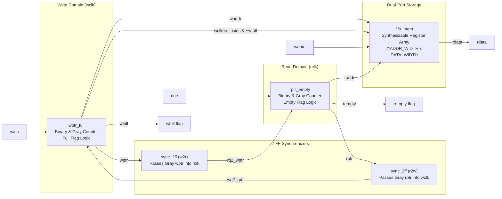

# Asynchronous FIFO Architecture & Design Specification

## 1. Overview
This design implements a dual-clock, parameterized Asynchronous First-In First-Out (FIFO) buffer in SystemVerilog. It safely bridges data transfers across two unrelated, asynchronous clock domains:
- **Write Domain**: Clocked by `wclk`, controlled by `winc`, reset by active-low `wrst_n`, producing `wfull`.
- **Read Domain**: Clocked by `rclk`, controlled by `rinc`, reset by active-low `rrst_n`, producing `rempty`.

## 2. Micro-Architecture Decomposition



### 2.1 Pointer Sizing & Memory Addressing
For a FIFO depth of $D = 2^N$ (where $N = \text{ADDR\_WIDTH}$):
- Memory addresses require $N$ bits: `waddr = wbin[N-1:0]`, `raddr = rbin[N-1:0]`.
- Pointers require $N+1$ bits (`wbin[N:0]`, `rbin[N:0]`).
- The extra $(N+1)^{\text{th}}$ bit acts as an epoch/wrap indicator to distinguish completely full from completely empty when addresses match.

### 2.2 Memory Model
- In synthesizable ASIC/FPGA code, the storage is modeled as a 2D register array.
- Reads are combinational (First-Word Fall-Through / FWFT) providing instantaneous read data at `rdata = mem[raddr]`.
- Memory writes are synchronously enabled by `wclken = winc & ~wfull`, guaranteeing that full-condition writes cannot corrupt memory contents.

---

## 3. Flag Generation Equations

### Empty Flag (`rempty`)
Evaluated in the `rclk` domain:
```systemverilog
assign rempty_val = (rptr_next == rq2_wptr);
```
- True when the read pointer has caught up with the synchronized write pointer.
- Pessimistic / Fail-Safe: Synchronizer latency (2 `rclk` edges) means `rempty` remains high for 2 cycles after data is written, but underflow is physically impossible.

### Full Flag (`wfull`)
Evaluated in the `wclk` domain:
```systemverilog
assign wfull_val = (wptr_next == {~wq2_rptr[ADDR_WIDTH : ADDR_WIDTH-1], 
                                   wq2_rptr[ADDR_WIDTH-2 : 0]});
```
- True when write has wrapped around read by exactly one full buffer capacity ($2^N$).
- Derivation: In Gray code, mirroring across $2^N$ inverts both the MSB and the 2nd MSB, while all lower bits ($N-2$ down to $0$) remain identical.
- Pessimistic / Fail-Safe: Full remains asserted for 2 `wclk` edges after items are popped, but overflow is physically impossible.
